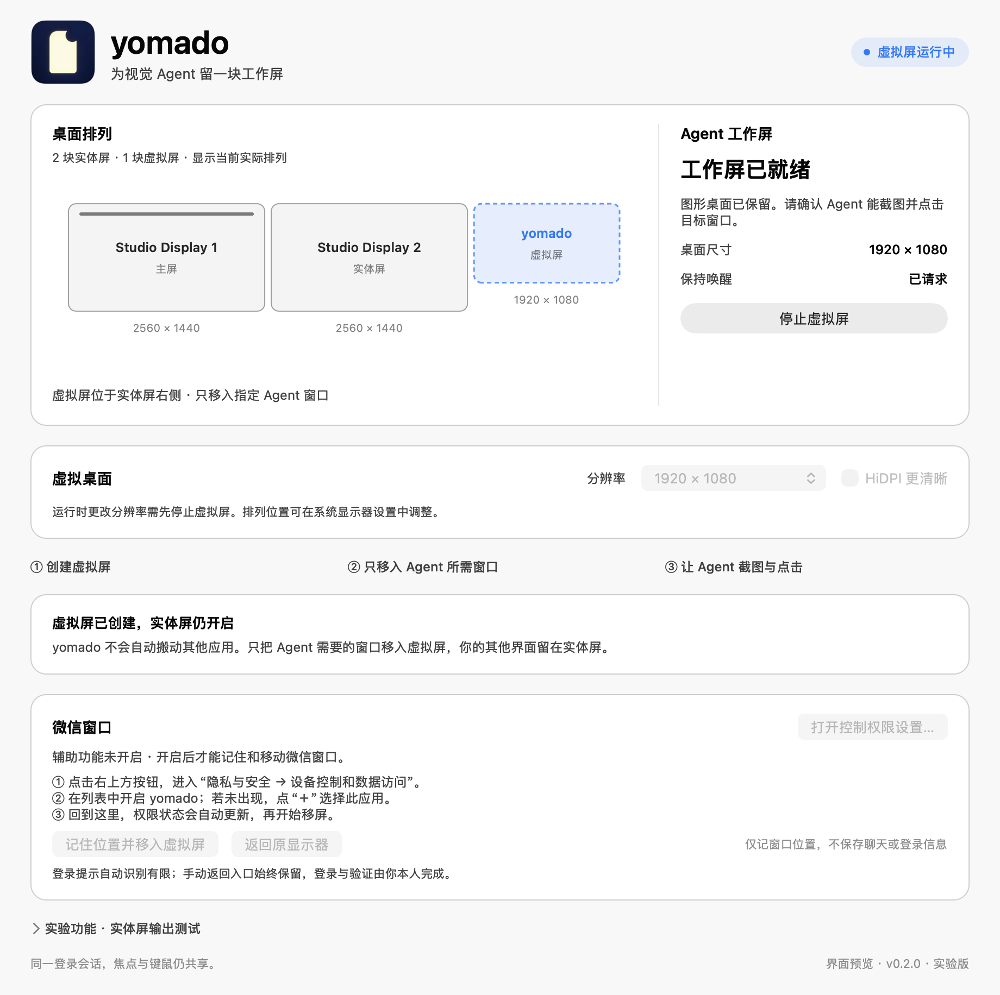

# yomado

A virtual display for visual computer use by Codex and other agents on macOS.

[简体中文](README.zh-CN.md) · [MIT license](LICENSE)

## Why yomado exists

yomado is built for **visual computer use**: Codex and other agents read screenshots, interpret the interface, and use the mouse and keyboard to operate desktop applications directly, without requiring an application-specific MCP integration. This matters for applications such as Marvelous Designer and Blender, especially when a workflow has no suitable MCP interface or needs interaction with a visible viewport, menu, or dialog.

These workflows still need a graphical desktop and a display surface for applications to render into. yomado provides a software virtual display for the windows an agent needs, with the goal of keeping those interfaces available while the Mac continues running and its physical monitors are off. Your existing agent tools handle screenshots, decisions, and input; yomado supplies the display. No hardware dummy plug or paid display utility is required.


*AI-generated usage illustration. Agent work belongs on the virtual display; operation with physical monitors off is still under validation.*

**Experimental prototype:** Yomado uses private macOS APIs. Compatibility can change with a system update. The goal is to keep graphical work available with a physical monitor off; actual monitor standby, power savings, agent operation after physical output is disabled, and long unattended operation have **not** been validated.

## What it does

- Creates a 1920 × 1080 or 2560 × 1440 virtual display, with optional HiDPI.
- Requests that the system and graphical desktop remain awake while the virtual display exists.
- Offers an optional, reversible trial that disables one selected physical display output.
- Includes a 15-second trial rollback, a recovery shortcut, and an independent recovery helper.

The virtual display belongs to your **existing login session**. It is not a separate operating system, user session, or isolated keyboard and mouse. Your agent and your own work share focus and input, so coordinate their use of the desktop. Yomado is not a remote desktop server or an agent: your existing tools still provide viewing, screenshots, and input.

## Control panel



*Native control-panel preview with example display data. This image does not validate target-app input or monitor standby.*

## Build

Requires macOS and Xcode or the Command Line Tools. The app uses system frameworks only; there are no third-party runtime dependencies.

```sh
bash ./build.sh
```

Outputs:

```text
dist/Yomado.app
dist/Yomado.zip
```

The build script selects the active Xcode or Command Line Tools installation through `xcrun`. Set `YOMADO_DEVELOPER_DIR` to select another developer directory.

The native Apple Silicon build has been verified. The macOS 14 deployment target is a build setting, not a claim that every macOS 14+ system or Intel Mac is supported. This repository publishes source; it does not claim an available prebuilt release.

Builds receive an **ad hoc signature**, not an Apple Developer ID signature or notarization. Follow your Mac's normal security policies when choosing whether to run a local build.

## Use the virtual display

1. Open your locally built `Yomado.app` and choose a resolution. HiDPI doubles each pixel dimension: a 1920 × 1080 logical desktop becomes 3840 × 2160 pixels.
2. Create the virtual display. Physical outputs remain enabled, with their existing main display and positions retained. The new virtual display starts to the right of the physical displays.
3. Keep a physical monitor as your main display. In macOS Displays settings, choose where the virtual display belongs in your arrangement.
4. Move **only the agent's work windows** and necessary dialogs onto the virtual display. Leave your other windows on your physical monitors. Yomado does not automatically migrate third-party application windows.
5. Select the virtual display in your existing viewing or agent tools, if they support that selection. Verify a fresh target-app screenshot and an actual reversible input action before starting work.

Changing displays, window positions, or scaling can invalidate an agent's saved coordinates. Refresh its screenshot and window state after each change. A successful screenshot does not by itself prove that keyboard or mouse input works.

Keep Yomado running while using its virtual display. Closing the control panel leaves the menu-bar app running. Stopping the virtual display or quitting removes it after attempting physical-output recovery. Removing a display can make macOS reposition windows; if you manually made the virtual display the main display, Yomado must first switch back to an available physical display. There is no automatic login startup or reboot recovery.

Yomado does not change passwords, lock-screen policy, screen savers, or login settings. Its wake requests do not unlock a Mac. Screenshot and input permissions remain the responsibility of the tools that perform those actions.

## WeChat window recovery (experimental)

The control panel can remember WeChat's physical-screen position before moving its main window to yomado. Choose **Remember position and move to virtual display**, then use **Return to original display** whenever you need to handle WeChat yourself. The menu-bar app also exposes the return action. Other applications are not moved.

If Accessibility permission is missing, the panel shows a guide and disables window movement. Choose **Open Control Permission Settings** (「打开控制权限设置…」) to open the relevant page under **Privacy & Security**, then enable yomado yourself. This page is called **Accessibility** on earlier macOS versions, and **Device Control & Data Access** on macOS 27. The guide uses the system's page name. If yomado is absent from the list, use **+** to select the app. The panel detects the updated permission automatically. Permission is requested only on that button click; opening the page does not grant it.

Local builds are ad hoc signed. After rebuilding, macOS may retain a permission record tied to an older signature even though its switch appears enabled. If the panel still reports no permission after reopening the app, remove the old yomado entry in System Settings, add the current app with **+**, and enable it again. yomado does not reset or edit system permission records itself.

While that move is pending, a limited check can recognize supported security/login dialogs and return WeChat to its physical screen without clicking the prompt. Ordinary chat-window contents are never scanned. Some WeChat versions do not expose those dialogs in a recognizable form; automatic return is not guaranteed, so keep the manual return action available. An automatic failure pauses further attempts. Stopping or quitting yomado is held if a pending WeChat return fails.

The local checkpoint stores only the application ID, display UUID, window position/size and a recovery flag, under `~/Library/Application Support/dev.chekusu.yomado/`. It does not store chats, contacts, screenshots, passwords or authentication state. Returning a window cannot restore a logged-out account; complete login or verification yourself. If the original display is unavailable, recovery uses an available physical display and constrains the window to its bounds.

This is window-placement recovery, not a claim that WeChat visual automation or logout recovery has passed end-to-end testing.

## Optional physical-output trial

**This is an experimental action, not the default workflow.** It changes the main display and arrangement, which can cause macOS or applications to move other windows. Save your work first and test only while you can directly reach the Mac and monitor.

1. Verify that your existing tools can view and control the virtual display while the physical monitors are still on.
2. Select one physical display in Yomado. Disable mirroring for that display before testing.
3. Start the 15-second physical-output trial and accept its confirmation dialog. Yomado makes the virtual display the main display, moves its own control panel there, and requests that the selected physical output be disabled. Other physical outputs remain enabled.
4. Check the actual monitor and perform a fresh target-app screenshot and reversible input action on the virtual display. Confirm within the countdown only if you can still operate it. Otherwise, Yomado attempts recovery after 15 seconds.

Recover with **Control + Option + Command + R** (`⌃⌥⌘R`), the recovery button, or the menu-bar recovery command. Stopping or quitting also attempts recovery.

The separate `YomadoWatchdog` helper monitors an armed trial's app heartbeat and virtual-display availability. If the app exits, its heartbeat expires, or the virtual display becomes unavailable, the helper attempts to re-enable the recorded physical output. It never disables an output itself.

These recovery paths are **best effort**. An API request can fail or a monitor may not respond. Software-disabled output and a black screenshot do not establish that a monitor entered standby or used less power; Yomado cannot cut power or measure consumption. Recovery also cannot guarantee each application's previous window positions.

## Diagnostics and tests

A read-only interface and display inventory check:

```sh
./dist/Yomado.app/Contents/MacOS/Yomado --diagnose
```

Physical display serial numbers are redacted by default. The optional `--include-device-identifiers` flag includes them for local diagnosis. Inventory output still describes your display setup; inspect and sanitize it before sharing.

The build script compiles, ad hoc signs, and strictly verifies the staged bundle. It does **not** launch the app or run display tests.

Pure policy tests can run without creating a display or opening an application:

```sh
bash ./test.sh
```

These tests check display placement, diagnostic redaction, and WeChat checkpoint/recovery policies. They do not exercise private APIs or prove that a live display configuration succeeds.

Render the control panel with example data, without reading or changing the display arrangement, inspecting WeChat or activating a window:

```sh
./dist/Yomado.app/Contents/MacOS/Yomado --preview-ui ./test-output/control.png running light
```

Create the output directory first. Preview states are `empty`, `running` and `trial`; appearances are `light` and `dark`. The renderer needs macOS AppKit/WindowServer and draws its own hidden views. A preview is not a live display or target-app test.

The following tests require an interactive macOS login session. **Do not run them automatically, in build-only CI, or while someone else is using the desktop.** They create and remove temporary displays and apply layout restoration, so windows may move. Save work and close other Yomado instances before running them.

```sh
./dist/Yomado.app/Contents/MacOS/Yomado --self-test ./test-output/standard
./dist/Yomado.app/Contents/MacOS/Yomado --self-test ./test-output/hidpi hidpi
./dist/Yomado.app/Contents/MacOS/Yomado --watchdog-test ./test-output/watchdog \
  ./dist/Yomado.app/Contents/MacOS/YomadoWatchdog
```

Lifecycle self-tests exercise a temporary virtual display, its dimensions, an app-owned AppKit view, virtual-output disable/re-enable, removal, and attempted layout restoration. The watchdog test uses a disposable process and a temporary virtual recovery target. Neither test deliberately disables a physical output.

Generated view images are **not** screenshots of Blender, Marvelous Designer, or another target application. Passing these tests does not validate an agent's input, physical monitor standby, energy savings, or unattended operation. Test receipts can contain display metadata; review them before sharing.

## Implementation

`app/Yomado.m` contains the AppKit app and test entry points. `app/ControlUI.*` draws the control-panel components; `app/WindowRecovery.*` and its pure policy header handle the opt-in WeChat window checkpoint. `app/Watchdog.m` contains the recovery helper; `bridge/VDVirtualDisplay.*` wraps the virtual-display interface. The application namespace is `dev.chekusu.yomado`.

The implementation uses private `CGVirtualDisplay` classes and dynamically discovers `CGSConfigureDisplayEnabled` / `SLSConfigureDisplayEnabled`. Feature availability is checked at runtime. Apple does not promise compatibility for these interfaces.

Contributions should preserve the distinction between creating a virtual display, changing display topology, and verifying real target-app operation. Keep diagnostics free of secrets and personal workflow data, and avoid running display-changing tests in automation.

## License

The [logo and usage illustration](docs/images/PROMPTS.md) were created with image generation; their prompts are included for reference.

[MIT](LICENSE).
