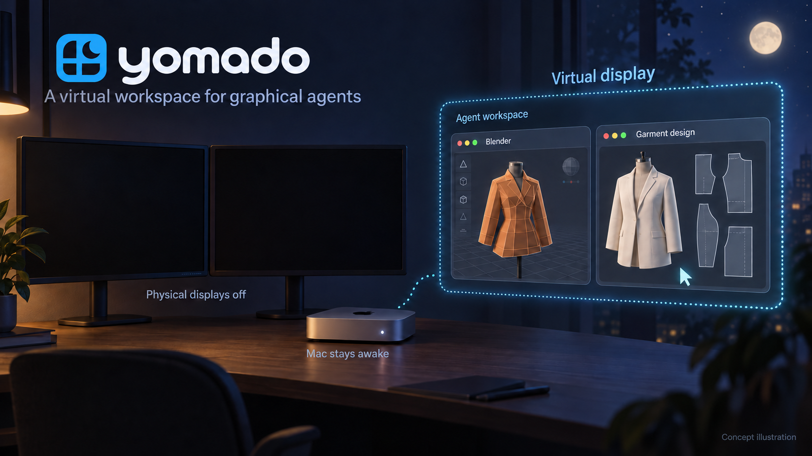

# yomado · 夜窗

给 macOS 上的图形 Agent 一块虚拟屏。

[English](README.md) · [MIT 许可证](LICENSE)

Yomado 为 Blender、Marvelous Designer 等应用创建额外的 macOS 显示器。把 Agent 需要的窗口移过去，再用现有的截图和电脑操作工具工作，无需购买其他显示器工具。



*AI 生成的使用示意：Agent 工作窗口位于虚拟屏；实体屏关闭后的实际操作仍待验证。*

**这是使用 macOS 私有 API 的实验原型。** 系统更新可能影响兼容性。目标是让实体显示器关闭后仍能进行图形工作；实体屏实际待机、节电效果、关闭实体输出后的 Agent 操作，以及长期无人值守运行，**目前都没有完成验证**。

## 功能和边界

- 创建 1920 × 1080 或 2560 × 1440 的虚拟显示器，可选 HiDPI。
- 在虚拟屏存在期间，请求系统和图形桌面保持唤醒。
- 提供可选的单台实体显示器输出关闭试验。
- 包含 15 秒试验回滚、恢复快捷键及独立恢复进程。

虚拟屏属于**当前登录会话**，不是独立的操作系统、用户会话或键鼠隔离环境。Agent 和你共用焦点与输入，需要协调桌面使用。Yomado 不提供远程桌面服务，也不是 Agent；查看、截图和输入仍由你原有的工具完成。

## 编译

需要 macOS，以及 Xcode 或 Command Line Tools。只依赖系统框架，没有第三方运行依赖。

```sh
bash ./build.sh
```

生成：

```text
dist/Yomado.app
dist/Yomado.zip
```

构建脚本通过 `xcrun` 使用当前 Xcode 或 Command Line Tools，也可以设置 `YOMADO_DEVELOPER_DIR` 选择其他开发工具目录。

目前验证过 Apple Silicon 原生构建。macOS 14 部署目标只是编译设置，不代表所有 macOS 14 及以上系统、或 Intel Mac 均已兼容。本仓库发布源码，不表示已有预编译发行版。

构建产物仅做 **ad hoc 签名**，没有 Apple Developer ID 签名或公证。是否运行本地构建，请遵循自己 Mac 的正常安全策略。

## 使用虚拟屏

1. 打开本地编译的 `Yomado.app`，选择分辨率。HiDPI 会将两个方向的像素数量各翻倍，例如 1920 × 1080 逻辑桌面对应 3840 × 2160 像素。
2. 创建虚拟屏。实体显示器仍保持输出，保留现有实体主屏和各实体屏位置；新虚拟屏初始位于实体显示器右侧。
3. 保留实体显示器作为主屏，在 macOS 的显示器设置里选择虚拟屏的排列位置。
4. **只把 Agent 所需的工作窗口及必要对话框移入虚拟屏**，自己的其他窗口留在实体屏。Yomado 不会自动迁移其他应用的窗口。
5. 如果现有查看或 Agent 工具支持选择显示器，选中虚拟屏。开始工作前，验证目标应用的新截图，以及一次实际、可逆的输入操作。

切换显示器、移动窗口或调整缩放后，旧坐标可能失效，需要重新获取截图和窗口状态。能截图不等于键盘、鼠标操作也已正常。

使用期间必须保持 Yomado 运行。关闭控制面板后，应用仍留在菜单栏。停止虚拟屏或退出应用时，会先尝试恢复实体输出，再移除虚拟屏。移除显示器可能使 macOS 重新排列窗口；如果你曾手动把虚拟屏设为主屏，Yomado 需要先切回可用的实体屏。目前没有登录自动启动或重启后恢复功能。

Yomado 不修改密码、锁屏策略、屏保或登录设置；保持唤醒的请求不能解锁 Mac。截图和输入权限由执行这些操作的工具自行管理。

## 可选：关闭实体输出试验

**这是实验操作，不是默认工作流程。** 试验会更改主屏及显示排列，macOS 或应用可能因此移动其他窗口。先保存工作，并仅在能够直接接触这台 Mac 和显示器时测试。

1. 在实体屏仍开启时，确认原有工具能看到并操作虚拟屏。
2. 在 Yomado 中选择一台实体显示器；测试前解除该显示器的镜像。
3. 开始 15 秒关闭输出试验，并接受确认框。Yomado 会把虚拟屏设为主屏，将自己的控制面板移过去，再请求关闭所选实体输出。其他实体输出保持开启。
4. 观察实体显示器，并验证虚拟屏上目标应用的新截图和一次可逆输入。仅在确认仍可操作时，于倒计时内确认继续。没有确认时，Yomado 会在 15 秒后尝试恢复。

恢复可按 **Control + Option + Command + R**（`⌃⌥⌘R`），也可使用恢复按钮或菜单栏恢复命令。停止虚拟屏、退出应用同样会尝试恢复。

独立的 `YomadoWatchdog` 进程监视已启动试验的应用心跳及虚拟屏可用性。应用退出、心跳过期或虚拟屏失效时，它会尝试重新启用记录中的实体输出；恢复进程本身不会关闭显示器输出。

这些措施**不能保证恢复成功**。接口请求可能失败，显示器也可能不响应。软件显示输出已关闭或截图变黑，都不能证明显示器进入待机、或者耗电降低；Yomado 无法切断电源或测量功耗。恢复也不能保证各应用的窗口回到原来位置。

## 诊断与测试

只读接口和显示器清单检查：

```sh
./dist/Yomado.app/Contents/MacOS/Yomado --diagnose
```

默认隐藏实体显示器序列号。需要本地诊断时，可加 `--include-device-identifiers` 参数将其包含在输出中。清单仍会描述你的显示配置，分享前应检查并清理。

构建脚本编译应用、进行 ad hoc 签名，并严格验证临时构建中的应用包，**不会**启动应用或运行显示器测试。

以下纯策略测试不会创建显示器或打开应用：

```sh
bash ./test.sh
```

它们检查显示放置与诊断脱敏策略，不调用私有 API，也不能证明真实显示配置能够成功应用。

以下测试需要交互式 macOS 登录会话。**不要自动执行、不要放入构建型 CI，也不要在别人正在使用桌面时执行。** 测试会创建、移除临时显示器，并应用排列恢复，可能导致窗口移动。先保存工作，并关闭其他 Yomado 实例。

```sh
./dist/Yomado.app/Contents/MacOS/Yomado --self-test ./test-output/standard
./dist/Yomado.app/Contents/MacOS/Yomado --self-test ./test-output/hidpi hidpi
./dist/Yomado.app/Contents/MacOS/Yomado --watchdog-test ./test-output/watchdog \
  ./dist/Yomado.app/Contents/MacOS/YomadoWatchdog
```

生命周期自检验证临时虚拟屏、尺寸、应用自有 AppKit 视图、虚拟输出关闭与重新启用、移除，以及排列恢复尝试。恢复进程测试使用可丢弃的子进程和临时虚拟恢复目标。两类测试都不会主动关闭实体输出。

生成的视图图片**不是** Blender、Marvelous Designer 或其他目标应用的屏幕截图。自检通过不等于 Agent 输入、实体屏待机、节电或无人值守运行已通过。测试记录可能包含显示器元数据，分享前请检查。

## 实现

`app/Yomado.m` 包含 AppKit 应用和测试入口；`app/Watchdog.m` 是恢复进程源码；`bridge/VDVirtualDisplay.*` 封装虚拟显示器接口。应用命名空间为 `dev.chekusu.yomado`。

实现使用私有 `CGVirtualDisplay` 类，并动态发现 `CGSConfigureDisplayEnabled` / `SLSConfigureDisplayEnabled`，运行时检查相关功能是否可用。Apple 不保证这些接口长期兼容。

贡献代码时，应区分创建虚拟屏、修改显示拓扑，以及验证真实目标应用操作。诊断记录不要包含密钥或私人工作流信息；自动化中不要运行会修改显示配置的测试。

## 许可证

[标志与使用示意图](docs/images/PROMPTS.md) 由 image generation 生成，仓库附有对应提示词。

[MIT](LICENSE)。
