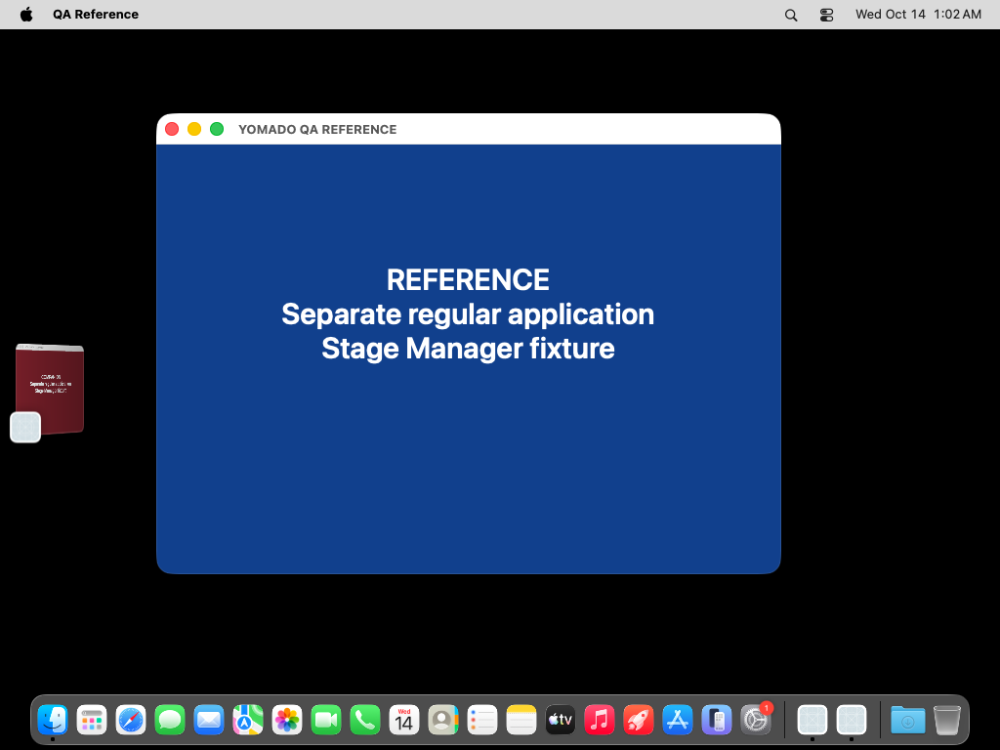
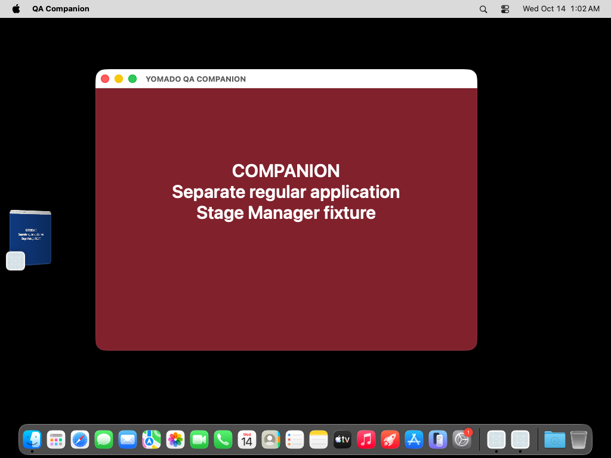
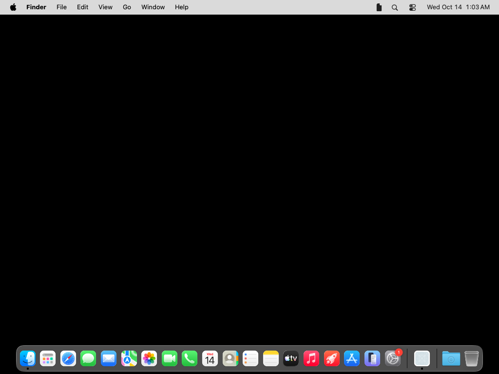
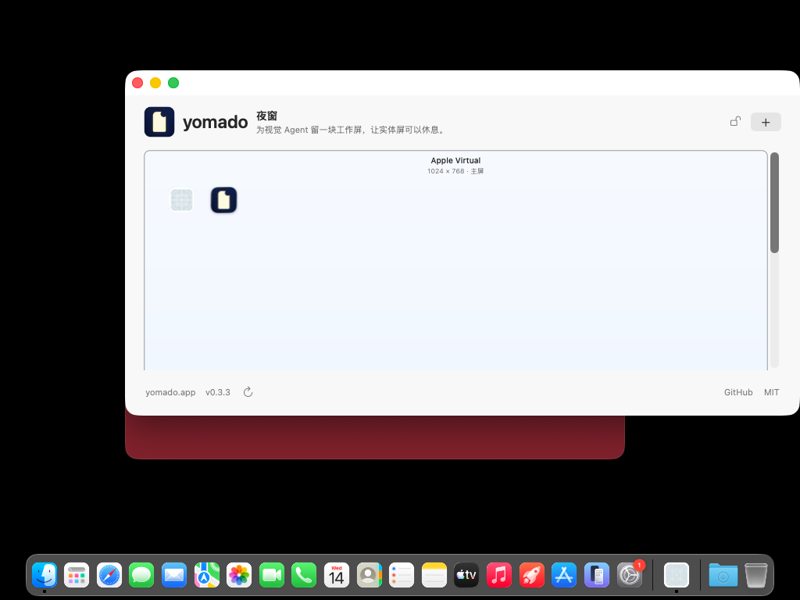
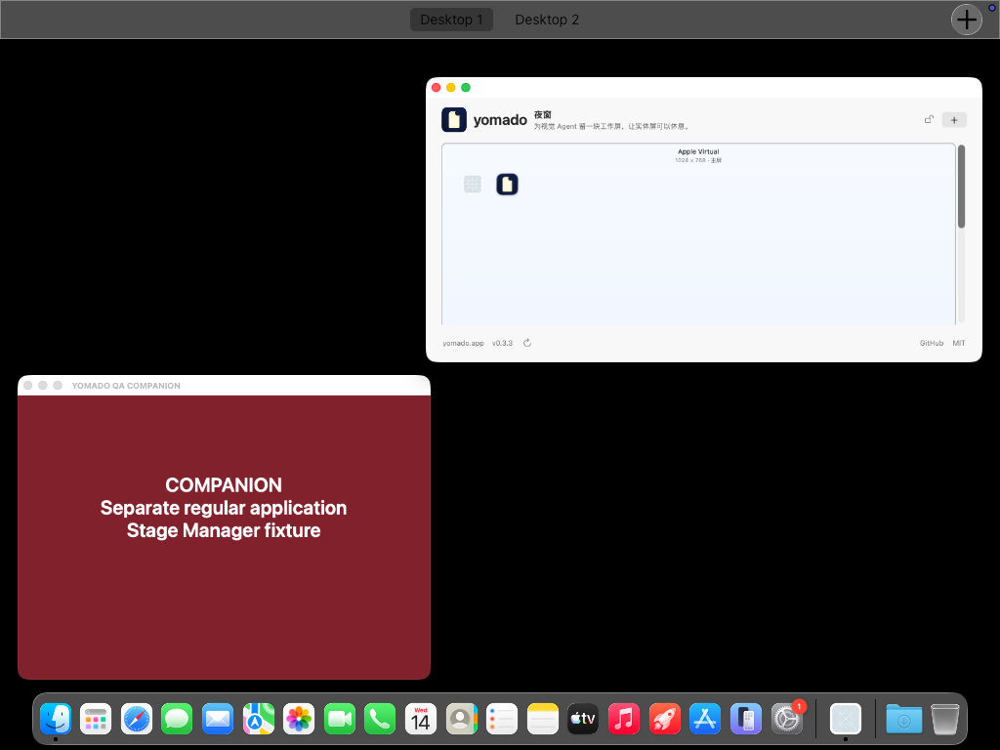
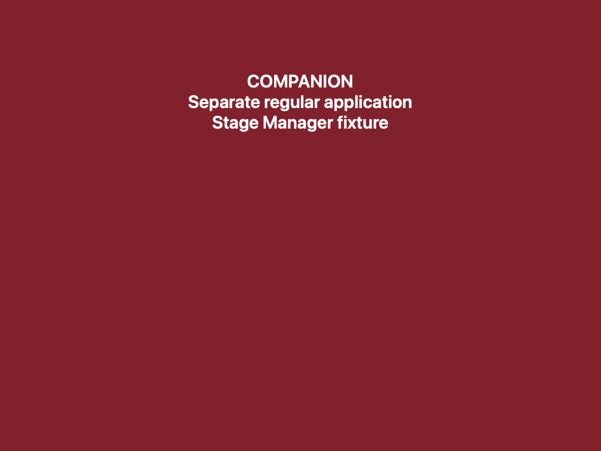
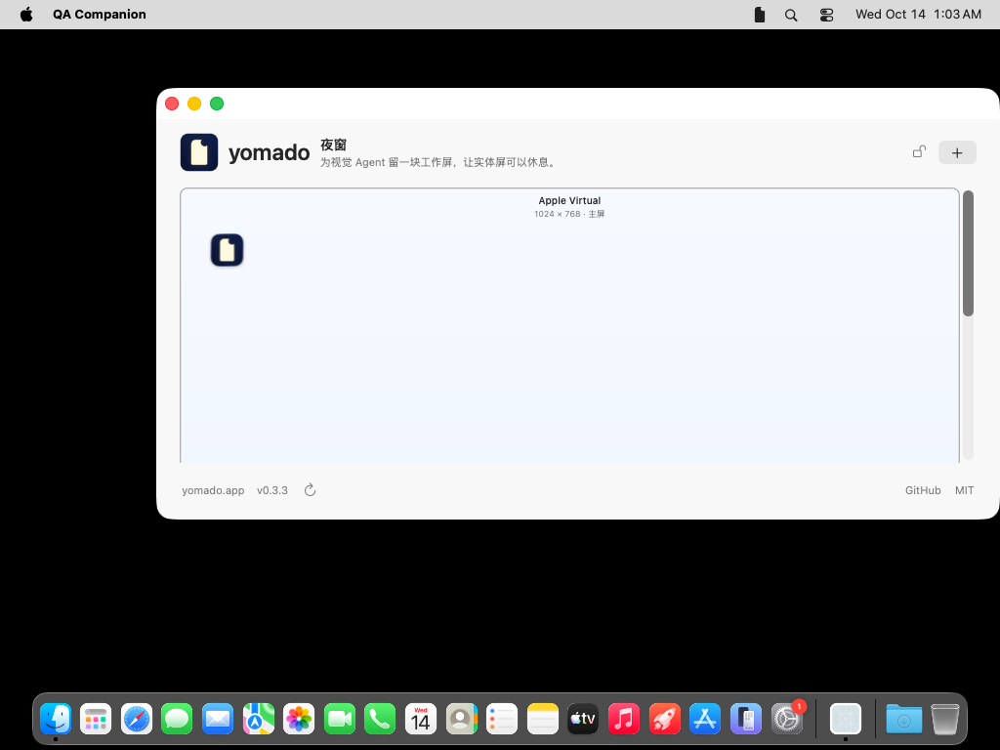
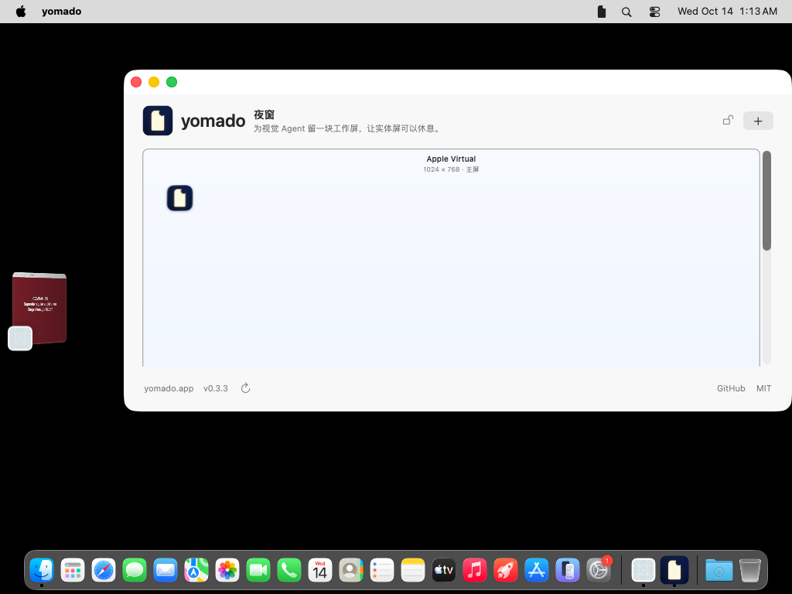
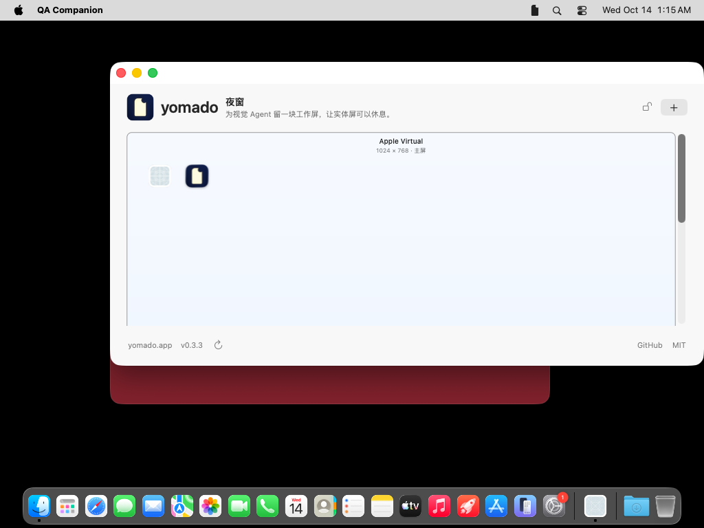

# PR #2: hosted macOS GUI evidence

**The Stage Manager separation check fails for this head. These results do not support merging PR #2 as a verified fix.**

- [PR #2](https://github.com/chekusu/yomado/pull/2)
- [Exact tested head: `0ba91754139c374f2bfcbd4600c43363642007b5`](https://github.com/chekusu/yomado/commit/0ba91754139c374f2bfcbd4600c43363642007b5)
- [GitHub Actions run 38493374039](https://github.com/chekusu/yomado/actions/runs/38493374039), `pr2-gui-head` artifact

The unchanged PR head ran in a disposable GitHub-hosted macOS **26.6.2 (25G83)** session with one 1024 × 768 display. This is not a macOS 27 result. The main evidence below comes from that job; the final two screenshots are explicitly labeled follow-up diagnostics. Every image is an original, unedited capture. Local user windows were not involved.

| Check | Observed result |
| --- | --- |
| Stage Manager positive control | Passed: two separate regular test apps alternate between the center and the recent-app thumbnail rail. |
| Yomado opens as a separate Stage Manager group | **Failed:** after a real status-menu click, the panel overlaps the still-centered Companion window. Yomado is active and its panel is key, but the independent group transition does not occur. |
| Request an existing panel from Desktop 2 | Returns to Desktop 1, where the panel was already located. |
| Close the panel, then request it from Desktop 2 | Also returns to Desktop 1. The same process and panel window are reused. |
| Request the panel while Companion is full-screen | Returns to an ordinary desktop with the panel visible; it does not overlay the full-screen Companion. |
| Dock icon and activation policy | All 556 readable samples report no Yomado Dock icon; all 540 samples with Yomado running report accessory policy. |

## Stage Manager

Reference is centered and Companion appears in the thumbnail rail:

Companion is centered and Reference appears in the thumbnail rail. This confirms functioning Stage Manager behavior, rather than relying on a preference value:

After closing and reopening Yomado through its actual “打开控制面板” menu item, Companion remains centered behind the panel. Both windows remain on screen at normal size:

## Ordinary desktops

Desktop 2 was selected through its observed Mission Control control. Requesting the existing panel returns to Desktop 1, confirmed by Mission Control:

| Before: Desktop 2 | After: panel shown | Confirmed desktop |
| --- | --- | --- |
|  |  |  |

After closing the panel and selecting Desktop 2 again, reopening gives the same result:

| Before: Desktop 2, panel closed | After: panel reopened | Confirmed desktop |
| --- | --- | --- |
|  |  |  |

The observations retain PID `3001` and CG window number `78` across both requests. They demonstrate reuse on Desktop 1, not movement to the caller's Desktop 2.

## Full-screen return

Companion first occupies a real full-screen Space (`AXFullScreen=true`):

Opening Yomado from the revealed menu bar returns to the ordinary desktop. Companion's full-screen window remains off that desktop until the fixture explicitly exits full-screen later:

## Limits

The Dock observer required a complete readable tree and detection of the regular Companion icon as a positive control. Its largest measured interval was **327.832 ms**; sampled absence cannot exclude a briefer flash between samples. The 16 samples without a running Yomado process are included in the 556 total.

The attempted minimize scenario was **not a verified minimize test**: `AXMinimized` remained `false`. Preservation of a manually assembled Stage Manager group was not verified in this run.

## Follow-up diagnostics: not a replacement for PR acceptance

[Run 38494385827](https://github.com/chekusu/yomado/actions/runs/38494385827) tested the unchanged head alongside bounded experimental variants. These observations do not establish a general platform limitation or a shippable fix. The Stage Manager failure remains a reason to keep PR #2 in draft.

**Regular-policy diagnostic — not shippable.** Changing Yomado to regular application activation policy produces the expected separate stage: Companion moves to the left thumbnail rail. It also creates a Yomado Dock icon, visible near the right end of the Dock and independently reported as present by the observer. This modified build is not the PR head and fails the menu-bar-only requirement:

**Unchanged head, Stage Manager off.** The real Control Center Stage Manager checkbox was available and unchecked (`AXEnabled=true`, `AXValue=0`) after switching it off. The actual menu action then opens the panel normally over Companion. This is an off-mode visibility check, not evidence of group separation:

The unchanged head's follow-up manual-group attempt stopped at its discovery guard (exit `78`); it did not verify preservation of a manually assembled group. The automatic Space-switching setting was not varied, and multiple displays were not tested.

Separate changes to activation order, early Primary assignment, synchronous activation, the legacy activation call, and explicit Managed behavior all failed to provide independent grouping in [run 38493886522](https://github.com/chekusu/yomado/actions/runs/38493886522). A fresh-process combination of early Primary assignment, synchronous activation, and removal of `orderFrontRegardless` also failed in the final run. None of those experimental changes was copied into the production PR.
